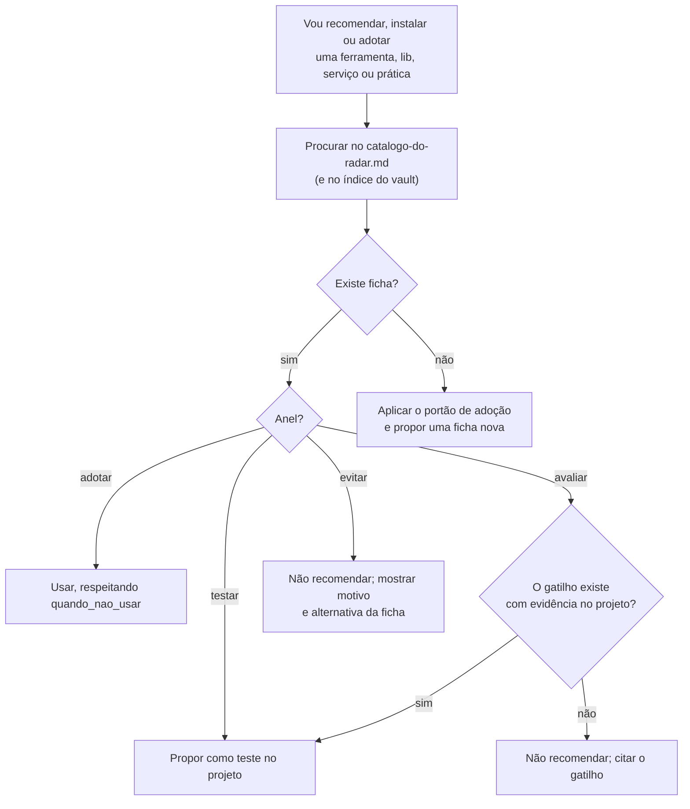

# Como usar o radar

## 📌 Para que serve

O **radar** guarda toda tecnologia, app, skill ou prática que foi **analisada** (quase sempre vinda de redes sociais), com um veredito e as condições de uso. Ele responde rápido à pergunta "**isso me serve, quando, e como?**", tanto para você quanto para os agentes.

> 💡 **Analogia:** a bula dos remédios da casa. Antes de tomar, você olha para que serve, quando não tomar e como tomar. Remédio novo só entra na caixa depois de ler a bula.

## 🎯 Os quatro anéis

| Anel | Significa | O que o agente faz |
| --- | --- | --- |
| ✅ **adotar** | Usar já, é padrão | Pode aplicar ou recomendar sem perguntar, respeitando o "quando não usar" |
| 🧪 **testar** | Experimentar num projeto antes de virar padrão | Recomendar no projeto indicado, deixar claro que é teste e registrar o resultado |
| ⏳ **avaliar** | Só quando o **gatilho** aparecer | Verificar se o gatilho (`quando_usar`) existe **com evidência** no projeto; sem gatilho, não recomendar |
| ⛔ **evitar** | Não usar agora | Não recomendar. Se o usuário pedir, mostrar o motivo da ficha e a alternativa. |

**Natureza** de cada item: `ferramenta` (app ou serviço), `skill` (skill ou regra de agente), `plataforma` (onde agentes rodam), `pratica` (processo ou método).

## 🗂️ Como a pasta está organizada

```text
murilo/radar/
├── como-usar-o-radar.md           ← esta regra
├── catalogo-do-radar.md           ← tabela de decisão de TODOS os itens (gerada)
├── open-source-self-hosted-triagem.md  ← registro do lote de 9 ferramentas open source
├── <categoria>/
│   ├── categoria-<categoria>.md   ← página simples com diagrama (para humano)
│   ├── <analise-comparativa>.md   ← comparações que cruzam itens da categoria
│   └── <item>/
│       └── <item>.md              ← FICHA: frontmatter de decisão + corpo
```

Categorias: `verificacao-e-qualidade` · `fluxo-com-agentes` · `plataformas-de-agentes` · `performance-web` · `produto-e-atendimento` · `produtividade` · `marketing-e-conteudo` · `ferramentas-de-agentes` · `seguranca` · `infraestrutura`.

**Ficha** é toda nota do radar que tem o campo `radar` no frontmatter. Campos de decisão, que o agente pode ler sem abrir o corpo:

```yaml
radar: adotar | testar | avaliar | evitar
categoria: <pasta da categoria>
natureza: ferramenta | skill | plataforma | pratica
quando_usar: "gatilho concreto"
quando_nao_usar: "limites e armadilhas"
pre_requisito: "o que precisa existir antes"
```

## 🤖 Protocolo do agente (antes de recomendar ou adotar algo)



Regras fixas:

1. **Pré-requisito primeiro.** Se o `pre_requisito` não existe no projeto, a recomendação é criar o pré-requisito, não o item.
2. **Analisar e registrar não é instalar.** Instalar, configurar ou alterar skill existente só com pedido explícito do usuário.
3. **Concorrentes:** se dois itens resolvem o mesmo problema, recomende um, nunca os dois.
4. **Ficha desatualizada:** se a fonte mudou (preço, licença, versão), diga isso e proponha atualizar a ficha, sem usar o dado velho como fato.
5. **Item fora do radar,** mas com nota no vault (estudo, convenção ou ADR): siga a nota e o ADR correspondente. Decisões de stack registradas em ADR (ex.: [[adr-001-observabilidade]]) valem mais que a ficha.

## ➕ Como registrar um item novo

1. Leia o [[adocao-de-ferramenta]] e verifique a **fonte primária**: repositório, documentação e preço. Para repositório viral, confira licença, número de contribuidores e commits versus estrelas, o que roda local e o que é API paga, e quem guarda as chaves.
2. Escolha a categoria. Se nenhuma servir, crie a pasta e a `categoria-<nome>.md`, e adicione o rótulo em `scripts/gerar-indices.py`.
3. Copie `templates/ficha-de-radar.md` para `murilo/radar/<categoria>/<item>/<item>.md`. O nome do arquivo precisa ser **único** no vault.
4. Preencha o frontmatter de decisão e as seções. Coloque o item na tabela da página da categoria.
5. Rode `./scripts/gerar-indices.py`, que atualiza o catálogo e os índices, e depois `./scripts/validar-vault.py`.

## 🔗 Ver também

- [[catalogo-do-radar]] · [[adocao-de-ferramenta]] · [[open-source-self-hosted-triagem]]
- Skill [radar-de-tecnologias](../ia/agentes/skills/radar-de-tecnologias/SKILL.md): este protocolo em forma de skill.
