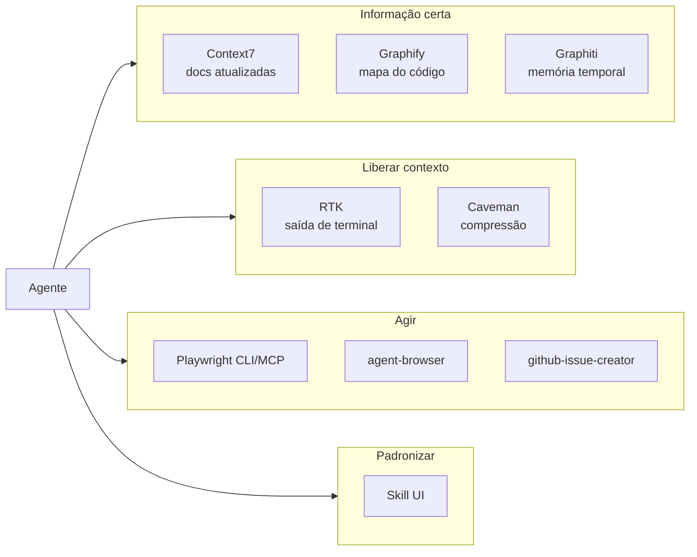
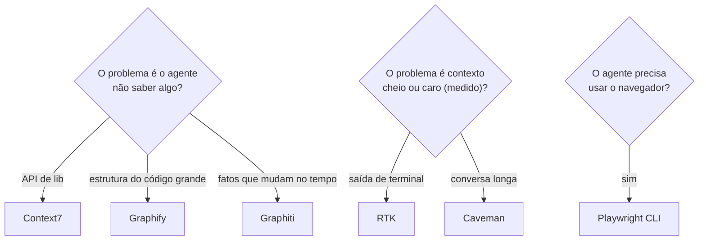

# Ferramentas de agentes

> **Em uma frase:** o que entra no contexto do agente e o que ele usa para agir. Cada ferramenta aqui **ocupa contexto**, então só entra a que paga o lugar.

## 🧠 A ideia em linguagem simples

O agente trabalha com uma "mesa" de tamanho fixo (a janela de contexto). As ferramentas desta categoria fazem uma de quatro coisas:

1. **Trazem informação certa:** documentação atualizada (Context7), mapa do código (Graphify), memória de longo prazo (Graphiti).
2. **Liberam espaço na mesa:** comprimem saída de terminal (RTK) ou a própria conversa (Caveman).
3. **Dão mãos ao agente:** navegador (Playwright, agent-browser), criação de issue.
4. **Padronizam o resultado:** regras de UI em forma de skill (Skill UI).

O erro comum é encher a mesa de ferramenta "porque pode ajudar". O pior caso é deixar o agente **instalar skills sozinho** (find-skills): contexto inchado e porta aberta para prompt injection.

> 💡 **Analogia:** a bancada de um eletricista. O multímetro e o alicate certos ficam à mão. A caixa inteira de ferramentas despejada na bancada só atrapalha.

## 🗺️ Mapa da categoria

## 📋 Itens da categoria

| Item | Radar | Quando usar | Ficha |
| --- | --- | --- | --- |
| Context7 | ✅ adotar | Lib que muda rápido ou migração de versão | [[context7]] |
| Playwright para agentes (CLI vs MCP) | ✅ adotar | CLI no terminal; MCP só em cliente sem shell | [[playwright-mcp]] |
| Skill UI (padrão de UI em skill) | ✅ adotar | Gerar ou auditar tela com agente | [[skill-ui]] |
| Caveman | ⏳ avaliar | Custo de token medido em sessão longa ou loop autônomo | [[caveman]] |
| RTK | ⏳ avaliar | Testes e linters ruidosos em sessão autônoma | [[rtk]] |
| Graphify | ⏳ avaliar | Codebase acima de ~30 mil linhas | [[graphify]] |
| Graphiti | ⏳ avaliar | Agente com memória de longo prazo (ex.: copiloto do AsyncHub) | [[graphiti]] |
| github-issue-creator | ⏳ avaliar | Triagem de bugs de terceiros tomando tempo | [[github-issue-creator]] |
| agent-browser | ⛔ evitar | Playwright cobre melhor | [[agent-browser]] |
| find-skills (auto-instalação de skills) | ⛔ evitar | Nunca pelo agente; só o humano pesquisando | [[find-skills]] |

## 🧭 Como decidir

## 🔗 Relacionados

- [[categoria-plataformas-de-agentes]] (onde o agente roda) · [[categoria-verificacao-e-qualidade]]
- Voltar ao [[catalogo-do-radar]] · [[como-usar-o-radar]]
