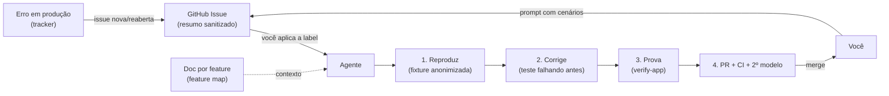

# Fluxo com agentes

> **Em uma frase:** como pedir, como o agente corrige e prova, como o erro de produção chega até ele, e onde ele encontra o contexto de cada feature.

## 🧠 A ideia em linguagem simples

Estas não são ferramentas, são **jeitos de trabalhar**. Vieram de uma série de reels sobre uma "equipe de engenharia de IA". A série acerta na espinha: **pedir com critério de pronto → reproduzir → corrigir → provar → revisar**. Erra ao tirar o humano do merge e ao usar dado de produção cru. Aqui fica a versão que cabe no seu estágio.

> 💡 **Analogia:** uma oficina. O cliente descreve o defeito com o critério de aceite (prompt). O mecânico reproduz o barulho antes de abrir o motor (repro), troca a peça (fix), roda com o carro (verificação) e o chefe confere antes de entregar (merge seu).

## 🗺️ O fluxo inteiro



## 🪜 Ordem de adoção (cada degrau depende do anterior)

```text
1. Prompt com cenários de verificação ── custo zero, já: em qualquer tarefa
2. verify-<app> + doc por feature ─────── primeiro projeto com UI (Encaixe)
3. Processo de correção de bug ─────────── precisa do 2 para reproduzir e provar
4. Captura de erros → issue → agente ──── precisa de usuários reais + 3
```

## 📋 Itens da categoria

| Prática | Radar | Gatilho para usar | Ficha |
| --- | --- | --- | --- |
| Prompt em três seções (objetivo, contexto, cenários) | ✅ adotar | Toda tarefa delegada. Versão longa só para feature ou mudança grande. | [[prompt-com-cenarios-de-verificacao]] |
| Correção de bug (reproduzir → corrigir → provar → revisar) | 🧪 testar | Bug não óbvio, reportado por usuário ou pelo tracker | [[correcao-de-bug-com-agentes]] |
| Dono por feature como documento no repositório | 🧪 testar | Junto com o `verify-<app>`: feature map com "onde mora no código" | [[bots-donos-de-feature]] |
| Captura de erros → issue → agente | ⏳ avaliar | Usuários reais gerando erro, ou triagem manual tomando tempo | [[captura-de-erros-para-agentes]] |

## 🧭 Regras que valem para todas

- **O merge é seu.** O auto-merge só entra pela escada de autonomia, com histórico, e nunca em migração, auth, RLS, pagamento ou dado pessoal.
- **Nunca dado de produção cru** no agente, na máquina local ou em captura de tela. Use fixture anonimizada que preserve o **formato** do dado.
- **Risco medido por script no CI**, não pela opinião do agente que fez a mudança.
- **Payload de erro é entrada não confiável** (prompt injection): a issue leva um resumo sanitizado e um link.

## 🔗 Relacionados

- Plataformas para rodar isso: [[categoria-plataformas-de-agentes]]
- Verificação e qualidade: [[categoria-verificacao-e-qualidade]]
- Voltar ao [[catalogo-do-radar]] · [[como-usar-o-radar]]
