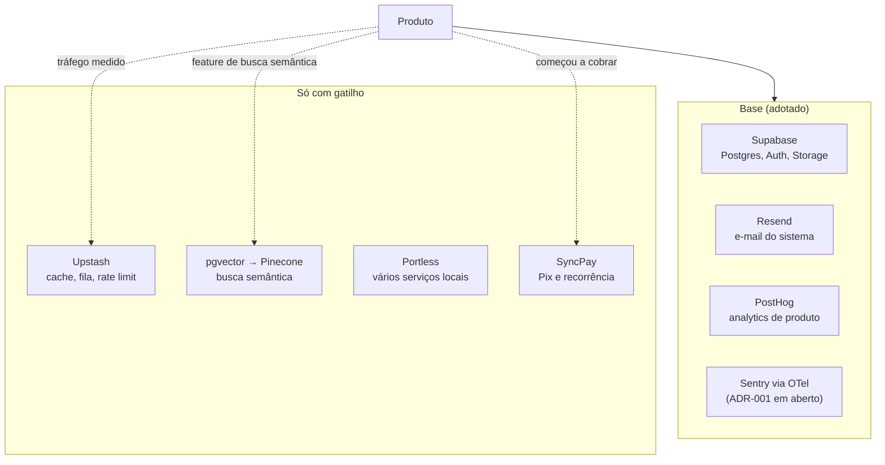

# Infraestrutura

> **Em uma frase:** os serviços de que o produto depende para existir (banco, login, e-mail, métricas, erros) e os que só entram quando o tráfego ou a feature pedirem.

## 🧠 A ideia em linguagem simples

O stack tem uma **base** que já está decidida e um **anexo** que só se monta quando precisar:

- **Base (usar já):** Supabase para banco, login e arquivos; Resend para e-mail do sistema; PostHog para saber onde o usuário trava. Para erros, Sentry, mas o ADR ainda está em aberto.
- **Anexo (com gatilho):** cache e fila (Upstash) quando houver tráfego; banco vetorial quando houver busca por significado; Portless quando vários serviços rodarem juntos; SyncPay quando o produto cobrar.

A regra é a mesma do [[adocao-de-ferramenta]]: um serviço novo é mais uma conta, mais um limite de free tier e mais uma coisa para quebrar.

> 💡 **Analogia:** uma casa. Água, luz e porta são a base, sem elas não dá para morar. Ar-condicionado e gerador entram quando o calor ou a queda de energia aparecerem.

## 🗺️ Base e anexos

## 📋 Itens da categoria

| Item | Radar | Quando usar | Ficha |
| --- | --- | --- | --- |
| Supabase (BaaS e limites do free tier) | ✅ adotar | Padrão dos produtos; acompanhar limites para trocar de plano | [[backend-como-servico]] |
| Autenticação (Supabase Auth; Clerk não) | ✅ adotar | Supabase Auth, já escolhido em ADR | [[autenticacao-gerenciada]] |
| Resend | ✅ adotar | E-mail disparado pelo sistema | [[email-transacional]] |
| PostHog | ✅ adotar | Onde o usuário trava, com poucos eventos-chave | [[analytics-de-produto]] |
| Observabilidade (Sentry + OTel) | 🧪 testar | Erros de produção, conforme ADR-001 | [[observabilidade]] |
| Upstash (cache e fila) | ⏳ avaliar | Tráfego real medido | [[cache-e-fila]] |
| Banco vetorial (pgvector, Pinecone) | ⏳ avaliar | Feature de busca semântica definida | [[banco-de-dados-vetorial]] |
| Portless | ⏳ avaliar | Vários serviços ou worktrees ao mesmo tempo | [[portless]] |
| SyncPay | ⏳ avaliar | Produto passando a cobrar com Pix | [[sync-pay]] |

## ⚠️ Decisão em aberto

O **PostHog também faz error tracking** (100 mil exceções/mês grátis), e o [[adr-001-observabilidade]] escolheu Sentry com a regra "uma plataforma por projeto". Antes de instrumentar erros, revise o ADR (skill `decisao-arquitetural`). Ver [[captura-de-erros-para-agentes]].

## 🔗 Relacionados

- [[adr-001-observabilidade]] · [[app-encaixe]] · [[app-asynchub]]
- Voltar ao [[catalogo-do-radar]] · [[como-usar-o-radar]]
