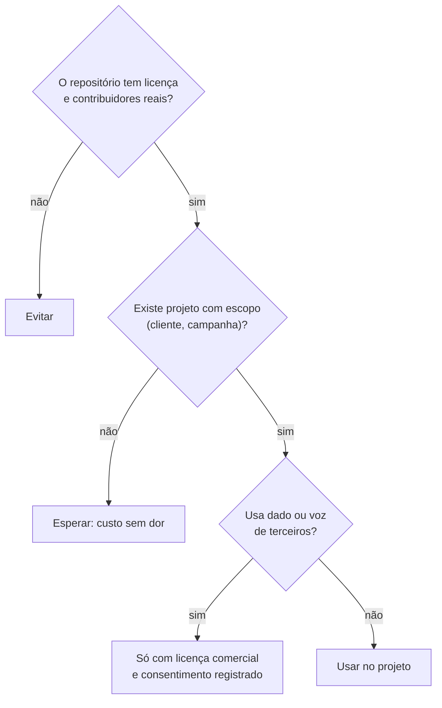

# Marketing & Conteúdo

> **Em uma frase:** ferramentas para aparecer (SEO) e produzir conteúdo (voz, imagem, vídeo). Entram **com projeto e escopo**, e o cuidado maior é com licença e dado de terceiros.

## 🧠 A ideia em linguagem simples

Nesta categoria, o custo e o risco ficam escondidos atrás do "open source":

- **OpenSEO** é gratuito, mas o dado vem de uma API paga por requisição (DataForSEO).
- **VoiceStudio** roda no seu computador, mas cada **modelo de voz** tem licença própria, e clonar a voz de alguém exige autorização.
- **Open Higgsfield** nem é open source de verdade: não tem licença, e a versão hospedada pede a sua chave de API.

> 💡 **Analogia:** um estúdio de gravação emprestado. O espaço é grátis, mas a fita, o técnico e a autorização do cantor não.

## 🧭 Como decidir

## 📋 Itens da categoria

| Item | Radar | Quando usar | Ficha |
| --- | --- | --- | --- |
| OpenSEO | ⏳ avaliar | Projeto de SEO ou AEO com escopo (ex.: Hamidi) | [[openseo]] |
| VoiceStudio | ⏳ avaliar | Narração ou dublagem com a sua voz ou com modelo de licença comercial | [[voicestudio]] |
| Open Higgsfield | ⛔ evitar | Nunca. Use o serviço oficial com a sua chave guardada. | [[open-higgsfield]] |

## 🔗 Relacionados

- [[aeo-geo-otimizacao-para-ia]] · [[open-source-self-hosted-triagem]]
- Voltar ao [[catalogo-do-radar]] · [[como-usar-o-radar]]
