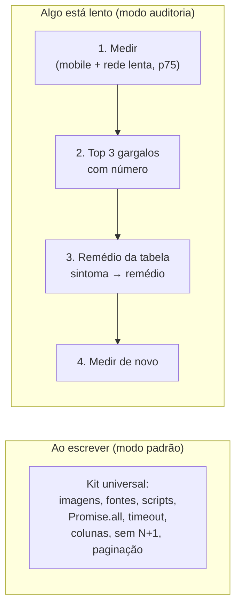

# Performance web

> **Em uma frase:** padrão barato sempre, remédio caro só com diagnóstico, e o termômetro antes de tudo.

## 🧠 A ideia em linguagem simples

Um reel listou 31 "pedidos" para o app não ficar lento. Quase todos são verdadeiros, mas são de três tipos diferentes:

- **Vitamina:** barato, vale em qualquer projeto (imagem otimizada, `Promise.all`, timeout, pedir só as colunas necessárias...).
- **Antibiótico:** resolve um gargalo específico e tem efeito colateral (Redis, fila, virtualização, optimistic UI...). Só com diagnóstico.
- **Termômetro:** medir no celular em rede lenta, ver a velocidade dos usuários reais e os traces. **Vem primeiro.**

E uma parte a Vercel e o Next **já fazem** sozinhos (CDN, compressão, cache de arquivo estático).

> 💡 **Analogia:** uma caixa de remédios. Protetor solar todo dia, antibiótico só com receita, termômetro antes de tudo.

## 🗺️ Como a skill trabalha

## 📋 Itens da categoria

| Item | Radar | Quando usar | Ficha |
| --- | --- | --- | --- |
| Kit de performance web (31 dicas → skill `performance-web`) | 🧪 testar | Ao escrever código web, e em auditoria quando algo estiver lento | [[performance-web-31-dicas]] |
| React Scan | ✅ adotar | Ver re-render em interação lenta antes de memoizar | [[react-scan]] |
| React Doctor | ✅ adotar | Auditoria de saúde de projeto React/Next | [[react-doctor]] |

## ⚠️ Armadilhas que a lista original esconde

- Imagem principal com lazy loading: o LCP piora.
- Skeleton de tamanho diferente do conteúdo: a página "pula".
- Optimistic UI em agendamento ou pagamento: mostra um sucesso que o servidor vai negar.
- Redis, fila e balanceador sem sintoma medido: overengineering.

## 🔗 Relacionados

- Skill [performance-web](../../ia/agentes/skills/performance-web/SKILL.md)
- [[react-scan]] · [[react-doctor]] · [[cache-e-fila]] · [[adr-001-observabilidade]]
- Voltar ao [[catalogo-do-radar]] · [[como-usar-o-radar]]
