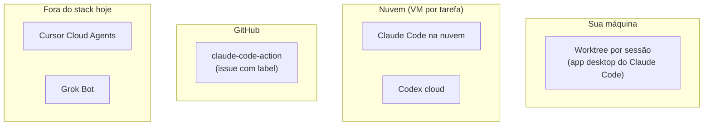
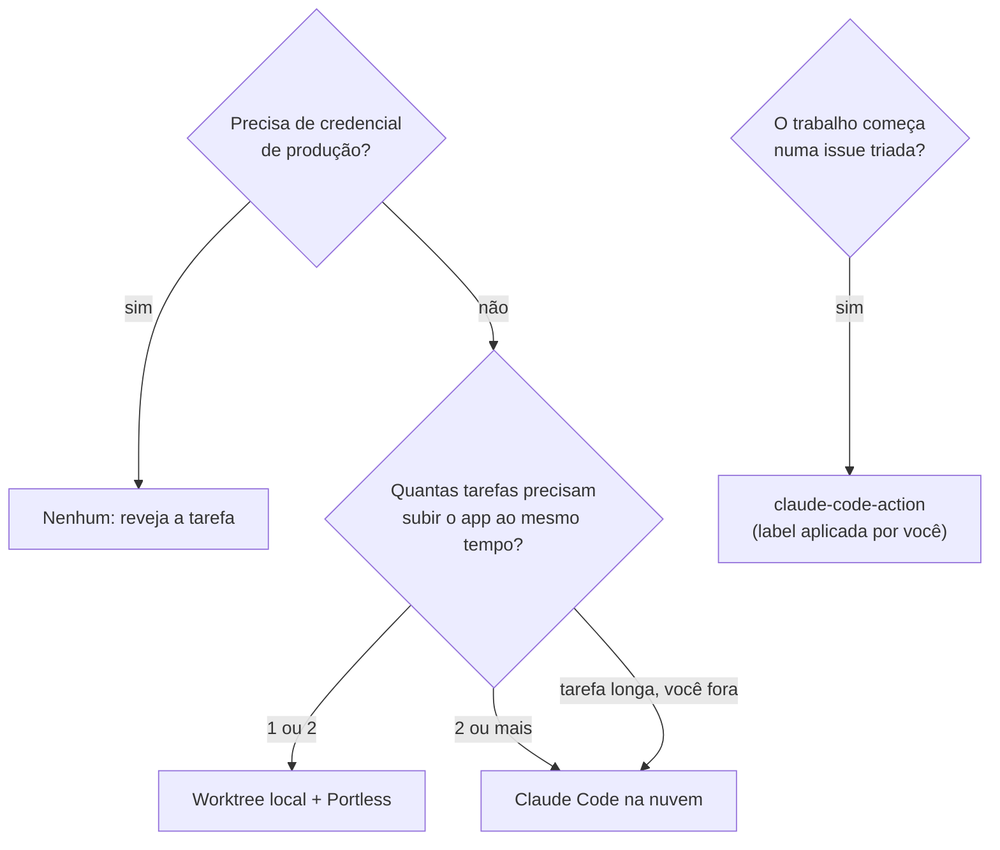

# Plataformas de agentes

> **Em uma frase:** onde o agente trabalha (sua máquina, uma VM na nuvem ou o GitHub) e quando vale tirar ele da sua máquina.

## 🧠 A ideia em linguagem simples

Editar código em paralelo é fácil: cada agente fica numa cópia dos arquivos (git worktree). O que trava é **verificar** em paralelo, porque cada agente precisa subir o próprio app e o próprio banco, e na sua máquina as portas e o banco colidem. É aí que uma VM na nuvem vale a pena. Você **já tem** isso no Claude Code e no Codex. Cursor Cloud Agents e Grok Bot fazem coisa parecida, mas seriam plataformas extras.

> 💡 **Analogia:** worktree é dar uma mesa para cada marceneiro na mesma oficina, dividindo a serra. A nuvem é dar uma oficina inteira para cada um. Para desenhar, a mesa basta. Para testar a peça montada, a serra compartilhada vira fila.

## 🗺️ Onde cada coisa roda

## 📋 Itens da categoria

| Plataforma | Radar | Quando usar | Ficha |
| --- | --- | --- | --- |
| Claude Code na nuvem | ⏳ avaliar | 2+ tarefas verificando o app ao mesmo tempo, ou tarefa longa com você fora | [[claude-code-na-nuvem]] |
| claude-code-action | ⏳ avaliar | Agente disparado por issue quando **você** aplica a label | [[claude-code-action]] |
| Cursor Cloud Agents | ⛔ evitar | Só se a Cursor virar seu ambiente principal | [[cursor-cloud-agents]] |
| Grok Bot | ⛔ evitar | Só com time maior e computador compartilhado sem logins sensíveis | [[grok-bot]] |

## 🧭 Como decidir onde rodar

## 🔗 Análises da categoria

- [[agentes-em-nuvem-vs-worktrees]]: comparação completa entre local e nuvem.
- [[portless]]: domínios locais por serviço, que resolve portas em worktree.
- Voltar ao [[catalogo-do-radar]] · [[como-usar-o-radar]]
