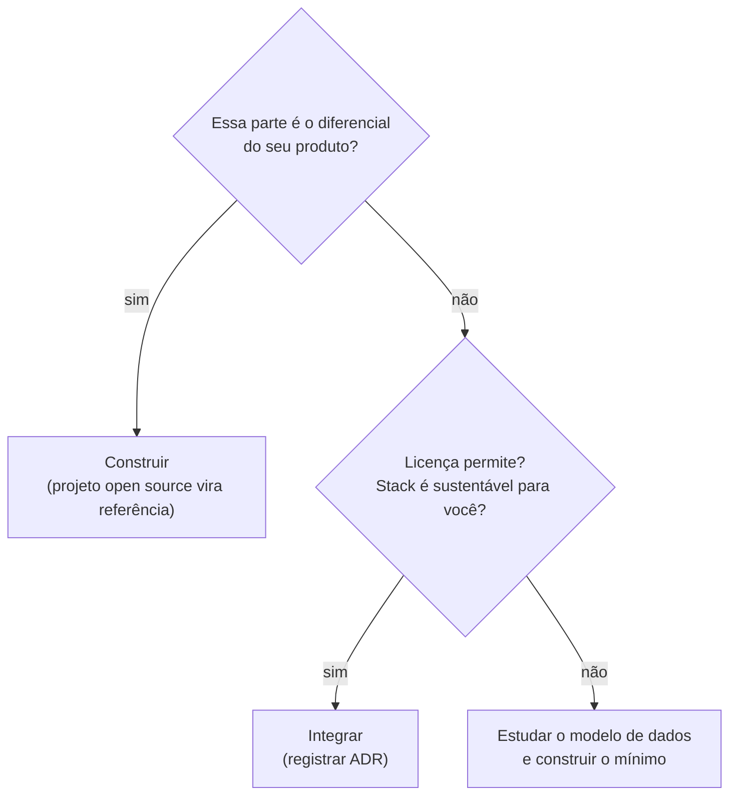

# Produto & Atendimento

> **Em uma frase:** projetos open source que fazem parte do que você está construindo. A pergunta não é "uso?", é **"construo, integro ou só estudo?"**.

## 🧠 A ideia em linguagem simples

Dois projetos da lista resolvem o mesmo problema que dois produtos seus:

- O **Chatwoot** já é um inbox de WhatsApp, Instagram e e-mail com atribuição de atendente, que é o núcleo previsto no **AsyncHub**.
- O **Cal.diy** já é um sistema de agendamento (disponibilidade, fuso, conflito de agenda), o mesmo terreno do **Encaixe**.

Isso não quer dizer abandonar os produtos. Quer dizer **não reinventar** o que já foi resolvido, e decidir conscientemente o que é diferencial seu.

> 💡 **Analogia:** antes de construir uma cozinha, visitar uma que já funciona. Você pode copiar a disposição da bancada (referência), comprar o fogão pronto (integrar) ou fazer tudo sob medida (construir), mas decide depois de ver.

## 🧭 Construir, integrar ou estudar

## 📋 Itens da categoria

| Item | Radar | Quando usar | Ficha |
| --- | --- | --- | --- |
| Chatwoot | ⏳ avaliar | Antes de começar o inbox do AsyncHub: entra no ADR | [[chatwoot]] |
| Cal.diy | ✅ adotar, como referência | Ao implementar ou depurar horários e fuso no Encaixe | [[cal-diy]] |

## 🔗 Relacionados

- [[app-asynchub]] · [[app-encaixe]] · [[open-source-self-hosted-triagem]]
- Skill [decisao-arquitetural](../../ia/agentes/skills/decisao-arquitetural/SKILL.md)
- Voltar ao [[catalogo-do-radar]] · [[como-usar-o-radar]]
