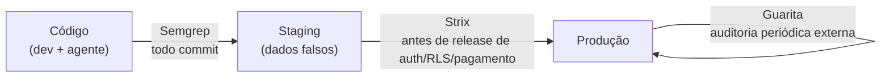

# Segurança

> **Em uma frase:** prevenir no código, atacar de propósito em staging e vigiar a porta de entrada em produção. São três momentos, e uma ferramenta não substitui a outra.

## 🧠 A ideia em linguagem simples

- **No código (todo dia):** o **Semgrep** lê o código e aponta padrões perigosos (injeção SQL, segredo exposto, RLS frouxo) antes do commit. É barato e roda sempre.
- **Em staging (antes de release sensível):** o **Strix** é um agente que **ataca de verdade** o app para achar falhas de lógica (acessar dado de outro usuário, pular login). Como ele ataca, **nunca** pode rodar em produção.
- **Em produção (de tempos em tempos):** o **Guarita** olha o site por fora (headers, TLS, cookies, LGPD), como um visitante mal-intencionado veria.

> 💡 **Analogia:** segurança de uma casa. Fechadura boa na construção (Semgrep), um teste de arrombamento contratado antes de mudar (Strix), e uma ronda periódica do lado de fora depois de morar (Guarita).

## 🗺️ Onde cada uma atua

## 📋 Itens da categoria

| Item | Radar | Quando usar | Ficha |
| --- | --- | --- | --- |
| Semgrep (Guardian / MCP) | ✅ adotar | Ao escrever ou revisar back-end, API, banco ou infra | [[semgrep-guardian]] |
| Strix | ⏳ avaliar | Staging isolado, antes de release que mexe em auth, RLS, webhook ou pagamento | [[strix]] |
| Guarita | ⏳ avaliar | Site ou app já em produção, em auditoria periódica | [[guarita]] |

## ⚠️ O que não fazer

- Rodar Strix contra produção ou contra dado real.
- Achar que SAST cobre autorização: regra de quem pode ver o quê se revisa e testa.
- Colocar dado de produção em ambiente de teste ou no contexto de agente ([[correcao-de-bug-com-agentes]]).

## 🔗 Relacionados

- Skill [semgrep-scan](../../ia/agentes/skills/semgrep-scan/SKILL.md)
- Voltar ao [[catalogo-do-radar]] · [[como-usar-o-radar]]
