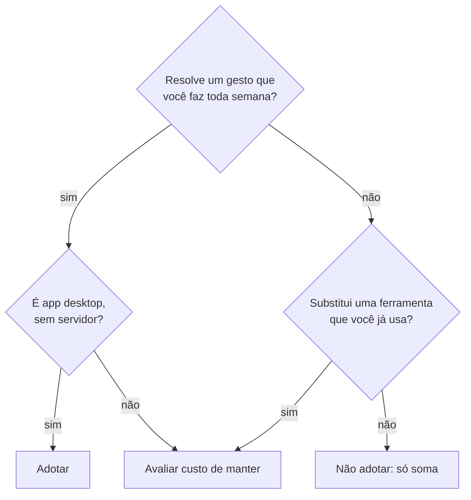

# Produtividade

> **Em uma frase:** ferramentas que deixam o seu dia mais rápido. Só entra o que **substitui** algo ou resolve uma dor, nunca o que só **soma** mais um lugar para olhar.

## 🧠 A ideia em linguagem simples

As ferramentas de produtividade se dividem em dois grupos:

- **App desktop leve, que resolve um gesto do dia:** falar em vez de digitar (OpenWhispr), gravar a tela em vez de marcar reunião (Cap). Custo quase zero e fácil de largar.
- **Plataforma de organização:** um Notion alternativo (AppFlowy) ou gestão de projeto pesada (OpenProject). Isso só vale se **substituir** algo, porque você já tem Notion, Obsidian, Trello e GitHub.

> 💡 **Analogia:** comprar uma caneta melhor é fácil e você usa amanhã. Trocar de agenda inteira só vale se a atual deixou de servir.

## 🧭 Como decidir

## 📋 Itens da categoria

| Item | Radar | Quando usar | Ficha |
| --- | --- | --- | --- |
| OpenWhispr | ✅ adotar | Ditar prompts longos e notas; transcrever reunião com o modelo local | [[openwhispr]] |
| Cap | ✅ adotar | Demo para cliente, bug gravado para a issue, entrega assíncrona | [[cap]] |
| AppFlowy | ⏳ avaliar | Só se decidir sair do Notion | [[appflowy]] |
| OpenProject | ⏳ avaliar | Só se um cliente exigir Gantt ou horas | [[openproject]] |

## 🔗 Relacionados

- [[open-source-self-hosted-triagem]] · [[prompt-com-cenarios-de-verificacao]]
- Voltar ao [[catalogo-do-radar]] · [[como-usar-o-radar]]
