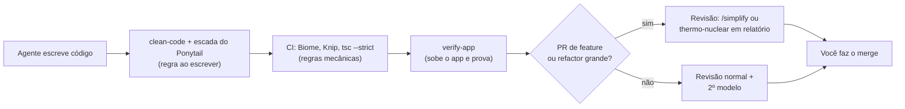
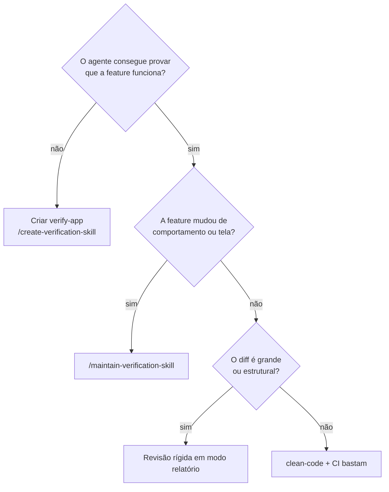

# Verificação & Qualidade

> **Em uma frase:** o agente só termina quando **prova** que funciona, e o código que ele deixa precisa ser o **menor e mais claro** possível.

## 🧠 A ideia em linguagem simples

São duas perguntas diferentes:

1. **Funciona?** Teste unitário passando não prova que o usuário consegue usar. A resposta vem de **subir o app e usar como um usuário**, guardando evidência. É o trabalho do `verify-<app>`, gerado pela skill do pstack.
2. **Está bem escrito?** Código de IA tende a inchar (lib desnecessária, wrapper, abstração "para depois"). A resposta vem em **três camadas que não se sobrepõem**: regra ao escrever, regra mecânica no CI e revisão humana ou de outro modelo no PR.

> 💡 **Analogia:** a vistoria de um carro. Primeiro você liga e anda com ele (funciona?). Depois olha se não sobrou peça solta nem fita isolante no motor (está bem feito?).

## 🗺️ Mapa da categoria

## 📋 Itens da categoria

| Item | Radar | Quando usar | Ficha |
| --- | --- | --- | --- |
| Ponytail (escada de decisão) | ✅ adotar | Ao escrever código. Já está dentro da `clean-code`. | [[ponytail]] |
| pstack: `create/maintain-verification-skill` | 🧪 testar | Projeto com UI em que o agente diz "pronto" sem provar | [[pstack]] · [[pstack-verificacao]] |
| Impeccable (59 regras de UI) | ✅ adotar | Ao gerar, editar ou auditar UI, para tirar a "cara de IA" | [[impeccable]] |
| Spec to Code Compliance | ✅ adotar | Validar entrega contra SPEC, PRD ou requisito de cliente | [[spec-to-code-compliance]] |
| Thermo-nuclear review | ⏳ avaliar | PR grande ou módulo perto de 1.000 linhas, só em relatório | [[thermo-nuclear-review]] |

## 🧭 Como decidir

## ⚠️ O que não fazer

- Empilhar Ponytail, thermo-nuclear e as skills de limpeza do pstack em **todo** PR: elas se contradizem (subtrair vs reestruturar) e o diff cresce. Ver [[skills-de-qualidade-de-codigo]].
- Deixar uma skill de revisão **aplicar** mudanças sozinha fora do escopo da tarefa.

## 🔗 Análises da categoria

- [[skills-de-qualidade-de-codigo]]: comparação da pilha de skills de qualidade do reel.
- [[pstack-verificacao]]: o par de skills de verificação, em detalhe.
- [[qualidade-automatizada]]: lint, código morto, testes no CI.
- Voltar ao [[catalogo-do-radar]] · [[como-usar-o-radar]]
